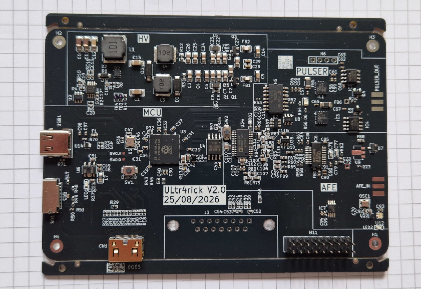
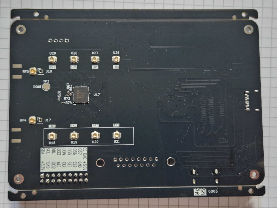
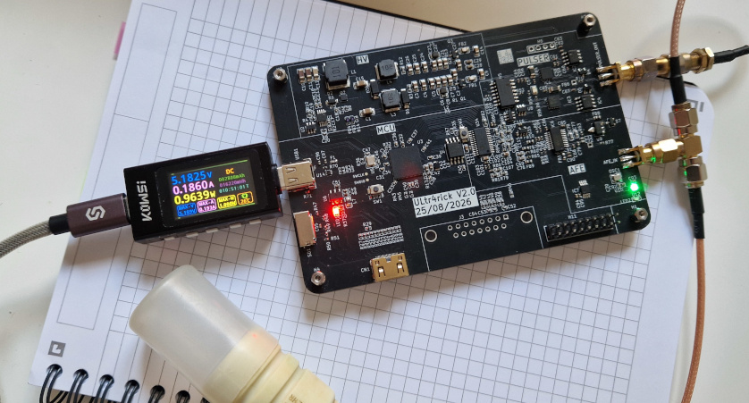
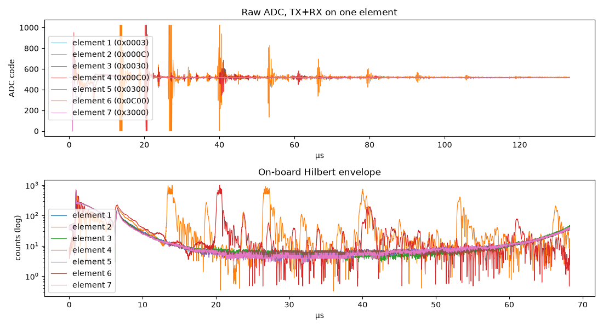
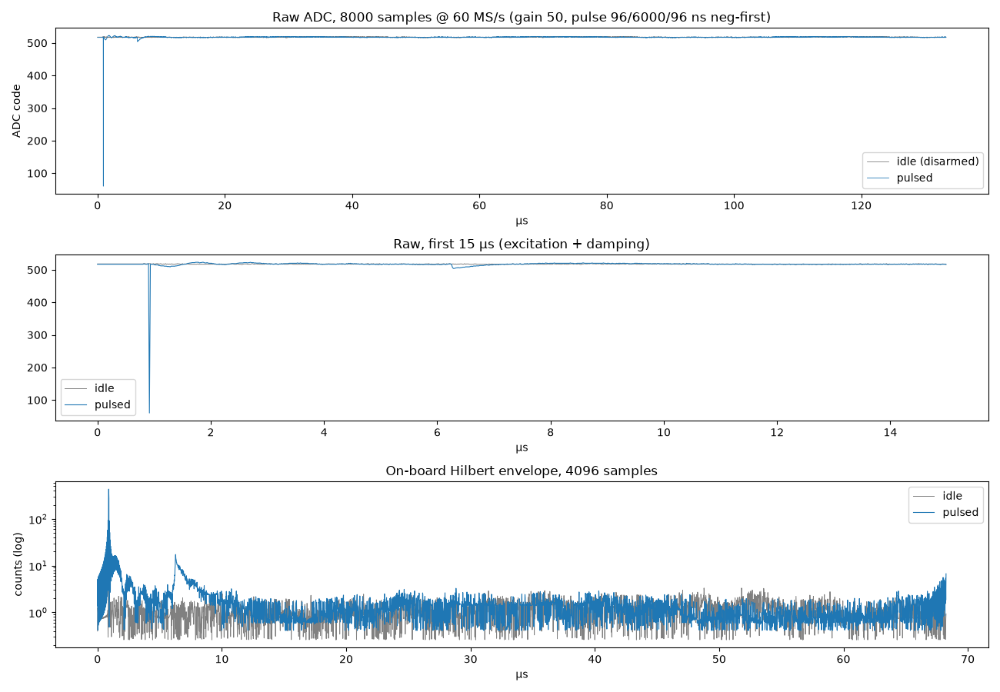

# ultr4rick

Ultr4rick is an open ultrasound pulse-echo board, the higher-power successor to
[pic0rick](https://github.com/kelu124/pic0rick). It is built around an **RP2350B** and has:

- a 10-bit, 60 MS/s ADC (AD9215) behind an AD8331 variable-gain front end, with gain set by an MCP4812 DAC;
- a bipolar HV pulser driven by two logic lines (A = negative, B = positive, A+B = damping), fed by a SEPIC HV supply;
- a MAX14866 16-channel HV mux;
- a uSD slot, an LP5562 RGB LED driver on I2C, and USB.

The firmware can compute the Hilbert envelope (and A-law compression) of each 4096-sample capture on the board.

## The board

<table>
  <tr>
    <td width="50%"><a href="docs/images/v0/v0_front.jpg"></a></td>
    <td width="50%"><a href="docs/images/v0/v0_back.jpg"></a></td>
  </tr>
  <tr>
    <td><b>Front.</b> HV supply, pulser, RP2350B and receive front end (AFE). <code>PULSER_OUT</code> and
      <code>AFE_IN</code> SMA connectors on the right edge, USB-C and uSD on the left.</td>
    <td><b>Back.</b> The MAX14866 HV mux and the 8 U.FL element connectors (U18–U21, U26–U29).</td>
  </tr>
  <tr>
    <td colspan="2"><a href="docs/images/v0/v0_working.jpg"></a></td>
  </tr>
  <tr>
    <td colspan="2"><b>Running.</b> Powered over USB-C (about 0.96 W on the inline meter), with one transducer on
      <code>PULSER_OUT</code> and <code>AFE_IN</code> through an SMA tee.</td>
  </tr>
</table>

The KiCad renders are in [`hardware/Ultr4rick_F.png`](hardware/Ultr4rick_F.png) and
[`hardware/Ultr4rick_B.png`](hardware/Ultr4rick_B.png). The photos are described in
[`docs/images/README.md`](docs/images/README.md).

## Acquisition examples

Pulse-echo on the mux: each element in turn on TX and RX with `set_one_mux(k)`, raw ADC trace (top) and on-board
Hilbert envelope (bottom). Elements 2 and 4 show echo trains: about every 13 µs on element 2 and every 20 µs on element 4. From
`python/example_dsp.ipynb`, section 13.



Idle vs. pulsed capture at gain 50, pulse 96/6000/96 ns: the excitation at 0.9 µs, the receiver recovering until
about 6 µs, and the envelope computed on the board. From `python/example_dsp.ipynb`, section 15.



## Repository layout

| Path | Contents |
|---|---|
| `docs/` | Documentation: [start here](docs/README.md) (introduction, setup and first acquisitions, firmware, Python library, repository map) |
| `hardware/` | KiCad project of the v2 board: schematic sheets per subsystem, PCB, gerbers, renders |
| `firmware/` | Pico SDK C firmware for the RP2350B. Pin map in [`firmware/PINMAP.md`](firmware/PINMAP.md), history in [`firmware/CHANGELOG.md`](firmware/CHANGELOG.md) |
| `python/` | `ultr4rick` host library, example script and notebooks. See [`python/Readme.md`](python/Readme.md) |
| `requirements.txt` | Python dependencies for `python/` |
| `TODO.md` | Hardware changes planned for the next revision |
| `LICENSE.md`, `LICENSES/` | Licenses per part of the repository |

## Quick start

Build the firmware (Pico SDK 2.3.0, `arm-none-eabi-gcc`, CMake + Ninja):

```bash
cd firmware
export PICO_SDK_PATH=$HOME/.pico-sdk/sdk/2.3.0
./build.sh -DPICO_TOOLCHAIN_PATH=/usr
# dist/ultr4rick-v<ver>-ultr4rick.uf2      stdio text REPL
# dist/ultr4rick-v<ver>-ultr4rick-dsp.uf2  on-board DSP + binary frames
```

Flashing:

1. Get the board into BOOTSEL. Either send `reboot-dfu` over the serial port, or hold BOOTSEL while plugging it in.
2. Copy the UF2 onto the `RP2350` drive that appears.

Drive it from Python:

```bash
python3 -m venv .venv && .venv/bin/pip install -r requirements.txt
cd python && ../.venv/bin/python example_dsp.py      # status, DSP self-test, captures
../.venv/bin/jupyter lab                            # example_dsp.ipynb, example_acquisition.ipynb, ...
```

```python
from ultr4rick.device import Ultr4rick
from ultr4rick import dsp
probe = Ultr4rick()                  # finds the board by USB ID
print(probe.status()["raw"])
print(dsp.check_selftest(probe.selftest()))
frame = probe.read_fft()             # 4096-sample Hilbert envelope
```

> **Safety:** the pulser generates high voltage. The firmware boots with it disarmed. Only arm it
> (`pulser arm` / `Ultr4rick.arm_pulser()`) with a transducer connected, and disarm it afterwards.

## License

- Hardware (`hardware/`): [TAPR Open Hardware License v1.0](LICENSES/TAPR-OHL-1.0.txt)
- Firmware (`firmware/`) and Python (`python/`): [GPL-3.0-or-later](LICENSES/GPL-3.0-or-later.txt)
- Documentation (`docs/` and the Markdown files): [CC BY-SA 4.0](LICENSES/CC-BY-SA-4.0.txt)

See [`LICENSE.md`](LICENSE.md) for the details and the third-party code.
