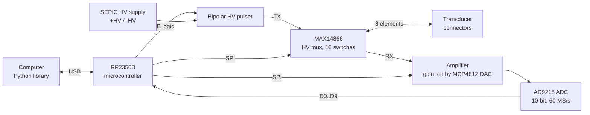

# 1. Introduction

Ultr4rick is an open-source ultrasound board. It sends a short high-voltage pulse into a piezoelectric transducer,
listens to the echoes that come back, and digitises them at 60 million samples per second. You drive it from a
computer over USB, with a Python library.

It is the higher-power successor of [pic0rick](https://github.com/kelu124/pic0rick). Typical uses are
non-destructive testing (measuring the thickness of a steel part, finding a flaw) and learning or prototyping
ultrasound imaging.

## How pulse-echo ultrasound works

1. **Transmit.** The board applies a short voltage pulse (tens to hundreds of nanoseconds) across the
   transducer. The piezo crystal vibrates and sends a burst of sound, typically a few MHz, into the material.
2. **Echo.** Wherever the sound meets a change of material (a back wall, a crack, a layer), part of it
   bounces back to the transducer.
3. **Receive.** The same transducer, or a second one, turns the returning sound into a small voltage. The
   board amplifies it, digitises it, and sends the trace to the computer.
4. **Measure.** The time between the pulse and an echo gives the distance: `depth = speed_of_sound × time / 2`
   (divided by 2 because the sound goes there and back).

At 60 MS/s, one sample is 16.7 ns. A full raw capture of 8000 samples covers 133 µs. That is about 98 mm of
depth in water (1480 m/s) or about 400 mm in steel (5950 m/s).

## What is on the board

*Front of a v0 board. The silkscreen marks the HV supply, the pulser, the MCU and the receive front end (AFE).
`PULSER_OUT` and `AFE_IN` are the SMA connectors on the right edge. USB-C and the uSD slot are on the left.*

| Block | Part | What it does |
|---|---|---|
| Microcontroller | RP2350B (2 cores, 48 GPIO) | Runs the firmware: drives the pulser, reads the ADC, computes the envelope, talks USB |
| ADC | AD9215 | Digitises the echo: 10 bits (codes 0..1023, about 512 at rest), 60 MS/s |
| Gain | MCP4812 DAC + front-end amplifier | Sets the receive gain (DAC value 0..1023) |
| Pulser | Bipolar HV pulser, logic lines A and B | A = negative pulse, B = positive pulse, A+B = damping |
| HV supply | SEPIC converter | Makes the +HV / -HV rails for the pulser |
| Mux | MAX14866, 16 HV switches | Connects one of 8 transducer connectors to transmit and/or receive |
| Status LED | LP5562 on I2C | Shows the firmware stage (see [Firmware](03-firmware.md#status-led)) |
| uSD slot | | Wired, not used by the firmware yet |

### The 8 elements and the mux

The board has 8 U.FL transducer connectors, called elements 1 to 8. Each element has two mux switches: one
connects it to the pulser (TX), the other to the receiver (RX). With both closed you do classic pulse-echo with one
transducer. With TX on one element and RX on another you do pitch-catch with two transducers.
[Setup](02-setup-first-acquisitions.md#select-an-element-on-the-mux) and
[Python library](04-python-library.md#mux) show how to select them.

*Back of a v0 board: the MAX14866 mux (U17) with the element connectors U18–U21 (elements 1–4, silkscreen TR1–TR4)
at the bottom and U26–U29 (elements 5–8) at the top. On v0 the top row is mislabelled TR4–TR7: go by the U number.*

The board also has two SMA connectors on its edge that bypass the element selection: `PULSER_OUT` (J1) is the
pulser output and `AFE_IN` (J2) the receiver input. A single transducer on both, through a tee, does pulse-echo
with the mux left open.

## Two firmware builds

The same hardware runs one of two firmware images (see [Firmware](03-firmware.md)):

- **DSP build** (recommended): the board computes the Hilbert envelope of each capture itself, and sends raw
  samples, envelopes or compressed (A-law) envelopes as binary frames. It can also stream continuously.
- **stdio build**: a simple text console that returns raw captures as text. It is easier to inspect by hand,
  but slower.

## Safety

- The pulser produces **high voltage** on the transducer connectors and on the TX path. Don't touch the
  connectors or the HV section while the board is powered.
- The firmware always boots with the pulser **disarmed**. In the DSP build, a capture only fires the pulser after
  `pulser arm` (`Ultr4rick.arm_pulser()`). Disarm it when you are done.
  In the **stdio build, every `start acq` fires the pulser**.
- `set mux` closes all 16 switches at once. This connects TX straight to the receiver and puts all elements in
  parallel. Prefer `clear mux` (all open) as the idle state, and never arm the pulser after a `set mux`.
- Only one program can use the serial port at a time. Close other serial monitors before running the library.

Next: [2. Setup and first acquisitions](02-setup-first-acquisitions.md).
