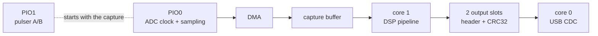

# 3. Firmware

The firmware in [`firmware/`](../firmware/) is C on the Raspberry Pi Pico SDK 2.3.0, for the **RP2350B** only. It
started as a fork of the pic0rick firmware (0.1.11). Its version is in
[`firmware/version.yaml`](../firmware/version.yaml) and printed by the `version` command. This page describes
firmware **0.1.15**.

## Two builds of one hardware layer

`firmware/build.sh` builds both variants from the same sources. CMake selects one with `-DDSP`:

| | stdio build (`main.c`) | DSP build (`main_dsp.c`, `-DDSP=ON`) |
|---|---|---|
| USB | SDK `stdio_usb`, `2e8a:0009` | Raw TinyUSB CDC, `cafe:4011`, serial `U4RK0001` |
| Interface | Text console, one command per line | Text commands, `OK …` / `ERR …` replies, plus binary `U4RK` frames |
| Capture | 8000 raw samples, printed as hex text | 8000 raw samples, or 4096-sample envelope / A-law computed on the board |
| Pulser | Every `start acq` fires it | Only fires when armed (`pulser arm`) |
| Streaming | No | Yes, up to 100 Hz raw / 50 Hz envelope / 70 Hz A-law |

Both run the image from SRAM (`copy_to_ram`, about 270 KB of the 520 KB), so timing doesn't depend on where the
code lands in flash.

## Boot sequence

1. `u4rk_acquisition_init()` runs first, before USB. It puts the pulser lines A/B at `00` (idle) and sets up the
   ADC capture.
2. The DAC, the shared SPI bus and the MAX14866 mux are initialised. The status LED turns white.
3. USB comes up. The LED turns green when the firmware is ready.

## The signal path

### Acquisition (`hw/acquisition.c`, `hw/acquisition.pio`)

PIO0 makes the 60 MHz ADC clock on GPIO0 and samples the 10 data bits on GPIO1–10. DMA copies the samples into the
capture buffer. A raw capture holds 8000 samples (133 µs). The envelope and A-law use the first 4096 (68 µs).

### Pulser (`hw/pulser.pio`)

One PIO1 state machine drives GPIO22 (A) and GPIO23 (B):

| B | A | Output |
|---|---|---|
| 0 | 0 | idle |
| 0 | 1 | negative pulse |
| 1 | 0 | positive pulse |
| 1 | 1 | damping |

A shot plays three phases: the first polarity, the second polarity, then damping, and returns to `00`. The order is
`neg-first` or `pos-first`. The tick is 8 ns, and every phase lasts at least 40 ns. The pulser starts together with
the capture, so time 0 of the trace is the excitation.

The pulser is disarmed again on USB disconnect, DMA fault, stream stop and reset.

### Gain DAC and mux on the shared SPI bus (`hw/spi_bus.c`, `hw/dac.c`, `max/max14866.c`)

SPI1 (SCK GPIO26, DIN GPIO27, mode 0, 2 MHz) is shared by two chips:

- **MCP4812 gain DAC**: chip select on GPIO11. Values 0..1023 set the receive gain.
- **MAX14866 HV mux**: it has no chip select. The firmware shifts in 16 bits, MSB first, then pulses nLE
  (GPIO21) low for 10 µs to apply them. SET (GPIO28) closes all switches, CLR (GPIO29) opens all of them.
  A DAC write also shifts bits into the mux, but they only take effect on an nLE pulse, so the firmware must
  never pulse nLE before shifting in a new mux word.

Mux bit *n* drives switch SW*n*. The switches are wired in pairs:

| Element | Connector | RX switch (to the receiver) | TX switch (to the pulser) | TX+RX pattern |
|---|---|---|---|---|
| 1 | U18 | SW0 | SW1 | `0x0003` |
| 2 | U19 | SW2 | SW3 | `0x000C` |
| 3 | U20 | SW4 | SW5 | `0x0030` |
| 4 | U21 | SW6 | SW7 | `0x00C0` |
| 5 | U26 | SW8 | SW9 | `0x0300` |
| 6 | U27 | SW10 | SW11 | `0x0C00` |
| 7 | U28 | SW12 | SW13 | `0x3000` |
| 8 | U29 | SW14 | SW15 | `0xC000` |

This comes from the netlist of `hardware/MUX.kicad_sch`: even COMs join `MUX_IN` (the receive input, `ECHO_IN`),
odd COMs join `MUX_OUT` (the pulser output, `TX`).

### DSP pipeline (`dsp/dsp.c`, `dsp/pipeline.c`)

Core 1 processes each 4096-sample capture:

1. **preprocess**: extract the 10-bit codes and subtract their mean (DC).
2. **forward FFT**: CMSIS-DSP `arm_rfft_fast_f32`, 4096 points, float32.
3. **mask**: keep the positive frequencies to form the analytic signal.
4. **inverse FFT**: gives the quadrature (Hilbert) component.
5. **magnitude**: `sqrt(real² + quadrature²)`, the envelope.
6. **A-law** (optional): compress the envelope to 8 bits with A = 87.6, relative to a reference (`dsp scale`,
   512 ADC counts by default).

Each stage's time is reported in `status` (`stages_us=`). The envelope takes about 6.55 ms (7.3 ms worst with
A-law). Only the float32 transform sources of CMSIS-DSP are compiled in.

Core 1 writes the result and its header into one of 2 output slots. If both slots are full, the frame is dropped
and counted; the firmware never blocks.

### Core 0 superloop (`main_dsp.c`)

Core 0 runs the USB task, parses commands, schedules streams, polls the capture and sends frames. Nothing on it
may block. A USB disconnect cancels the session and disarms the pulser.

## Binary frames (`dsp/protocol.c`)

Every capture in the DSP build is sent as a 64-byte little-endian header followed by the payload:

| Field | Type | Notes |
|---|---|---|
| magic | 4 bytes | `U4RK` |
| version | u8 | protocol version, 1 |
| payload_type | u8 | 1 = raw (u16 per sample), 2 = envelope (f32), 3 = A-law (u8) |
| flags | u16 | bit 0 A-law saturated, 1 processing drop, 2 USB drop, 3 self-test, 4 pulser armed; bits 8+ self-test case |
| sequence | u32 | frame counter |
| sample_count | u32 | 8000 raw, 4096 envelope / A-law |
| sample_rate_hz | u32 | 60 000 000 |
| payload_bytes | u32 | |
| capture_timestamp_us | u64 | board time |
| adc_dc_mean | f32 | mean of the raw codes |
| envelope_peak | f32 | |
| alaw_reference | f32 | |
| negative_ns, damp_ns, positive_ns | 3 × u32 | pulse settings used |
| dropped_frames | u32 | |
| payload_crc32 | u32 | CRC32 of the payload |

If you change the header, change `python/ultr4rick/dsp.py` (`HEADER`, `MAGIC`) in the same commit.

## Command reference

### DSP build

Replies are one text line, `OK 
` or `ERR <CODE> <message>` (`BUSY`, `ARG`, `RANGE`, `RATE`). Commands
that change settings answer `ERR BUSY` while a capture or stream is running.

| Command | Reply / effect |
|---|---|
| `help` | the command list |
| `status` | `board=ultr4rick package=RP2350B firmware=… pulser=… pulse=… dac=… stream=… drops=… stages_us=… dsp_us=…` |
| `version` | firmware version, change summary, board, mux, build hash, release URL (several lines) |
| `reboot-dfu` | reboots into the USB bootloader (`RP2350` drive) |
| `pulser arm` / `pulser disarm` | arms / disarms the pulser |
| `pulse config <neg_ns> <damp_ns> <pos_ns> <neg-first\|pos-first>` | `OK pulse=…`, minimum 40 ns per phase |
| `dac write <0..1023>` | sets the receive gain, `OK dac=…` |
| `dsp scale <reference>` | A-law reference in ADC counts |
| `dsp selftest` | `OK selftest frames=21 cases=7`, then 21 frames (7 cases × raw / envelope / A-law) |
| `acq <raw\|envelope\|alaw>` | one capture: `OK capture started …`, then one frame |
| `read_raw` / `read_fft` | same as `acq raw` / `acq envelope` |
| `stream start <raw\|envelope\|alaw> <rate_hz>` | periodic frames until `stream stop` (only frames are sent while streaming) |
| `stream stop` | `OK stream stopped drops=…` |
| `write mux <hex>` | loads a 16-bit switch pattern, `OK mux=…` |
| `set mux` / `clear mux` | closes / opens all 16 switches |

### stdio build

| Command | Effect |
|---|---|
| `start acq [pon_ns] [poff_ns] [damp_ns]` | fires the pulser (positive first, defaults 200/200/2000) and captures 8000 samples |
| `read` | prints the last capture as hex values between `Start of ACQ` / `End of ACQ` lines |
| `write dac <0..1023>` | sets the receive gain |
| `write mux <hex>`, `set mux`, `clear mux` | as in the DSP build |
| `version`, `reboot-dfu` | as in the DSP build |

## Status LED

The LP5562 RGB LED (I2C0, GPIO24/25) shows what the firmware is doing, dimmed to 5%:

| Colour | Stage |
|---|---|
| white | booting |
| green | ready, idle |
| yellow | capture (and pulse) running |
| blue | core 1 computing a frame |
| magenta | frame being sent over USB |
| red | DMA fault (held briefly) |

The separate white LED (W channel) is on while a program has the serial port open.

## Pins

See [`firmware/PINMAP.md`](../firmware/PINMAP.md). Short version: ADC clock GPIO0, data GPIO1–10, DAC CS GPIO11,
mux nLE/SET/CLR GPIO21/28/29, pulser A/B GPIO22/23, I2C0 GPIO24/25, SPI1 GPIO26/27, uSD GPIO30/31 and 40–43
(not used yet).

## Building and versions

- `./build.sh -DPICO_TOOLCHAIN_PATH=/usr` builds `dist/ultr4rick-v<ver>-{ultr4rick,ultr4rick-dsp}.uf2`.
- The board definition is `firmware/boards/ultr4rick.h`: RP2350B, 12 MHz crystal, W25Q128 16 MiB flash.
- `version.yaml` holds `A.B.C` and a one-line change summary, which are embedded in the binary. The history is in
  [`firmware/CHANGELOG.md`](../firmware/CHANGELOG.md).

## Known limitations

- The first capture after an idle period has a transient at the start of the frame. Discard it.
- The envelope takes 6.55 ms, above the 4.5 ms target. A 50 Hz envelope stream is limited by USB.
- The uSD slot is wired but not driven yet.
